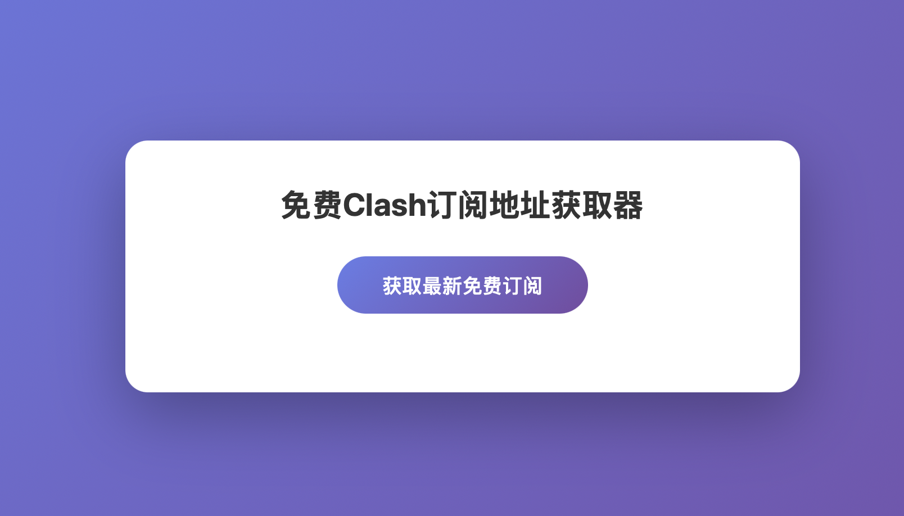
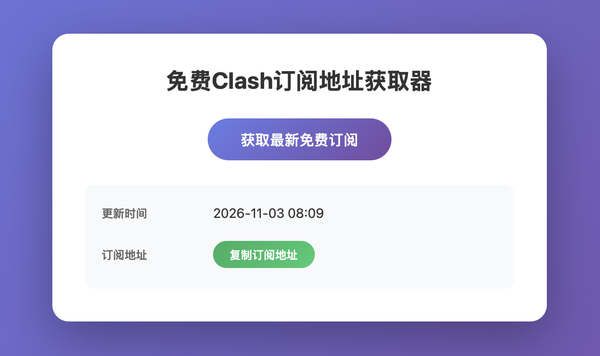

# 免费Clash订阅地址获取器

**在线访问地址：** [待上线]

一个用于获取最新免费 Clash 订阅地址的 Web 应用。

## 功能特点

- 自动获取最新发布的免费节点信息
- 实时显示订阅地址更新时间
- 获取 Clash / Mihomo 免费订阅地址（YAML 格式）
- 提供简洁的 Web 界面展示结果
- 一键复制免费订阅地址
- 订阅地址更新检测 - 自动对比新旧订阅地址并提示更新状态
- 数据持久化 - 使用 SessionStorage 存储数据，刷新页面后自动回显

## 使用方法

1. 访问在线地址
2. 点击"获取最新免费订阅"按钮
3. 查看更新时间
4. 点击"复制订阅地址"按钮获取订阅链接
5. 将订阅地址粘贴到 Clash 客户端中即可使用

## 界面预览

## 常见问题

**Q: 订阅地址多久更新一次？**
A: 订阅地址由源网站维护，通常每天更新。您可以随时点击"获取最新免费订阅"按钮检查是否有更新。

**Q: 订阅地址失效了怎么办？**
A: 免费节点可能随时失效，建议定期检查更新。如果当前地址失效，请重新获取最新订阅地址。

**Q: 支持哪些客户端？**
A: 支持所有兼容 Clash / Mihomo YAML 格式的客户端，包括 Clash for Windows、Clash for Android、ClashX、Mihomo 等。

**Q: 为什么复制按钮没有反应？**
A: 请确保浏览器允许剪贴板访问权限。如果仍有问题，可以尝试刷新页面后重试。

## 注意事项

- 本项目仅用于学习和研究目的
- 请遵守相关网站的使用条款
- 订阅地址的有效性由源网站维护
- 订阅地址可能随时失效，请及时更新
- 使用免费节点时请注意保护个人隐私
- 建议不要用于敏感操作
