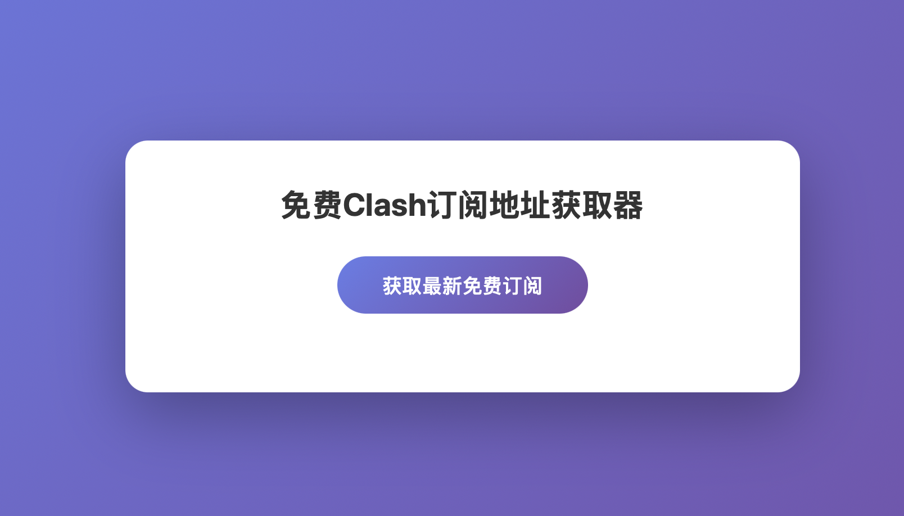
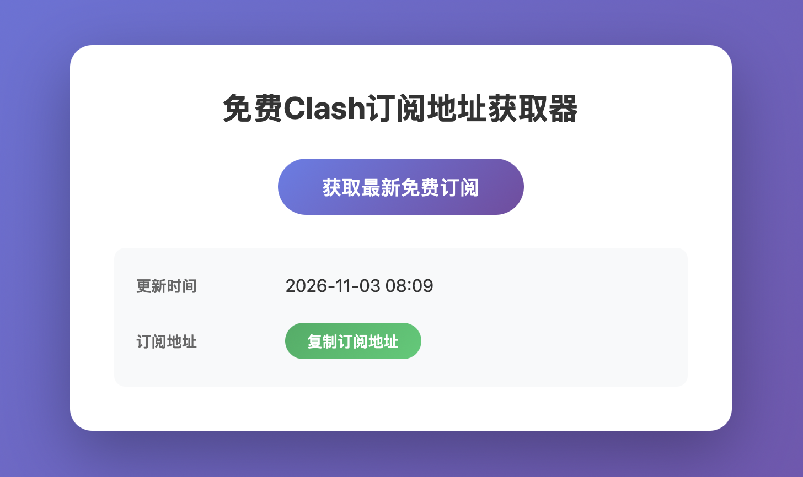

# 免费Clash订阅地址获取器

**在线访问地址：** [待上线]

一个用于获取最新免费 Clash 订阅地址的 Web 应用。

## 功能特点

- 自动获取最新发布的免费节点信息
- 实时显示订阅地址更新时间
- 获取 Clash / Mihomo 免费订阅地址（YAML 格式）
- 提供简洁的 Web 界面展示结果
- 一键复制免费订阅地址
- 订阅地址更新检测 - 自动对比新旧订阅地址并提示更新状态
- 数据持久化 - 使用 SessionStorage 存储数据，刷新页面后自动回显

## 使用方法

1. 访问在线地址
2. 点击"获取最新免费订阅"按钮
3. 查看更新时间
4. 点击"复制订阅地址"按钮获取订阅链接
5. 将订阅地址粘贴到 Clash 客户端中即可使用

## 界面预览





## 本地运行

需要 Node.js 20 及以上版本。

```bash
# 安装依赖
npm install

# 启动服务，默认端口 3000
npm start

# 指定端口启动
PORT=8080 npm start
```

启动后访问 <http://localhost:3000>。

## Docker 部署

项目自带 [Dockerfile](Dockerfile) 与 [docker-compose.yml](docker-compose.yml)。

```bash
# 构建并启动容器（映射 3000:3000）
docker compose up -d --build

# 查看日志
docker compose logs -f

# 停止并移除容器
docker compose down
```

### 使用 Portainer 部署（可选）

如果服务器上已有 [Portainer](https://www.portainer.io/)，可以直接通过 Git 仓库部署本项目：

1. 登录 Portainer，进入 **Stacks → Add stack**
2. 输入 Stack 名称，例如 `clash-fetcher`
3. 选择 **Git repository**，填写：
   - Repository URL：本仓库地址
   - Repository reference：`main`
   - Compose path：`docker-compose.yml`
4. 点击 **Deploy the stack**，等待构建完成

日常运维：

- 查看日志：**Containers → clash-fetcher → Logs**
- 重启服务：**Containers → clash-fetcher → Restart**
- 更新项目：提交代码后进入 **Stacks → clash-fetcher → Editor → Update the stack**

更完整的安装与操作说明见 [Portainer 使用教程](docs/requirements/Portainer使用教程_副本.txt)。

## API 接口

### `GET /api/scrape`

抓取最新免费节点页面，返回更新时间与订阅地址。

成功响应：

```json
{
  "title": "2026年11月18日 免费节点",
  "date": "2026-11-18 10:00",
  "subscriptionUrl": "https://example.com/xxx.yaml"
}
```

失败响应（状态码 500）：

```json
{
  "error": "错误信息"
}
```

## 项目结构

```
server.js            # Express 服务：静态托管 + /api/scrape 抓取接口
public/index.html    # 前端页面（HTML/CSS/JS 单文件）
images/              # README 截图
Dockerfile           # 生产镜像构建
docker-compose.yml   # 容器编排
```

## 常见问题

**Q: 订阅地址多久更新一次？**
A: 订阅地址由源网站维护，通常每天更新。您可以随时点击"获取最新免费订阅"按钮检查是否有更新。

**Q: 订阅地址失效了怎么办？**
A: 免费节点可能随时失效，建议定期检查更新。如果当前地址失效，请重新获取最新订阅地址。

**Q: 支持哪些客户端？**
A: 支持所有兼容 Clash / Mihomo YAML 格式的客户端，包括 Clash for Windows、Clash for Android、ClashX、Mihomo 等。

**Q: 为什么复制按钮没有反应？**
A: 请确保浏览器允许剪贴板访问权限。如果仍有问题，可以尝试刷新页面后重试。

## 注意事项

- 本项目仅用于学习和研究目的
- 请遵守相关网站的使用条款
- 订阅地址的有效性由源网站维护
- 订阅地址可能随时失效，请及时更新
- 使用免费节点时请注意保护个人隐私
- 建议不要用于敏感操作
